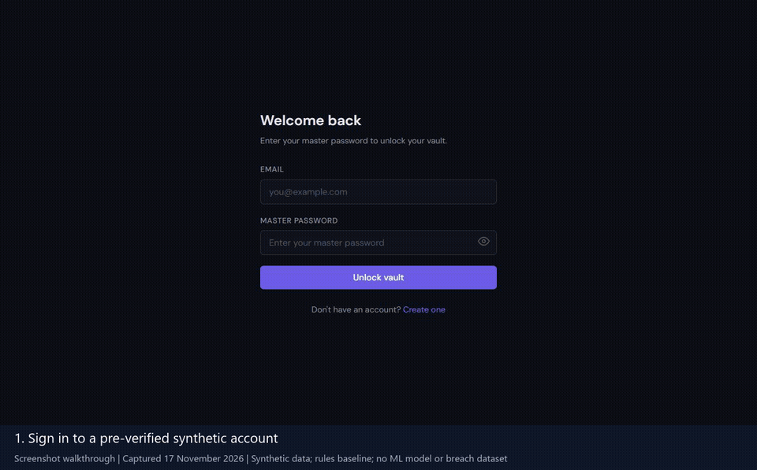

# PassMetric

**A password vault with explainable strength analysis and security auditing.**

PassMetric brings credential storage, password generation and password assessment into one web application. Users can manage their vault, inspect why a password receives a particular strength rating, and audit stored credentials for weak or known breached passwords.

Developed as a final-year Computer Science project at the University of Sussex. Built with **Python, Flask, SQLite, scikit-learn and vanilla JavaScript**.

## See it in action

[](docs/media/walkthrough.mp4)

[Watch the 38-second live dashboard walkthrough](docs/media/walkthrough.mp4) ·
[Animated preview](docs/media/walkthrough.gif) ·
[Reproduction steps and capture notes](docs/DEMO.md)

The continuous recording shows vault search and note editing, generator options,
password analysis and a health audit, with no added captions or footer. It uses
synthetic data and the rules baseline; no trained ML
model or breach corpus was loaded. The vault's quick scores and the full analyser
currently differ; the demo notes record this and the test results.

## Features

| Area | What it does |
|---|---|
| Credential vault | Add, edit, delete and search credentials; reveal or copy passwords; record creation and password-change dates. |
| Explainable analysis | Return a score, strength category, estimated entropy, detected patterns and practical recommendations. |
| Optional machine learning | Classify passwords with a Random Forest and combine its verdict conservatively with the rule-based result. |
| Password generation | Generate random passwords with selected character types, or passphrases using an optional EFF wordlist. |
| Vault audit | Report average password score, weak-password count and breach matches across stored entries. |
| Account management | Email verification, vault locking, master-password changes, email changes and account deletion. |
| Application controls | CSRF protection, request limits, temporary account lockout, security headers and optional hCaptcha. |

## How the analysis works

The rule-based evaluator checks length, character diversity, common passwords, dictionary words, repetitions, keyboard sequences, years and common character substitutions. It uses an estimated character-space entropy value alongside these checks to produce a score out of 100 and explanations for the result.

When a trained model is available, a Random Forest predicts `WEAK`, `MEDIUM` or `STRONG` using 12 extracted features. The combined verdict takes the lower of the rule-based and ML strength categories. Without a model, the rule-based evaluator continues to work.

The model uses automatically labelled samples from a local RockYou corpus and generated examples of strong passwords. Its predictions reflect that training setup; they are not measured password-cracking times. Breach checks use exact matches against the locally installed corpus, rather than an external API.


## Technology stack

| Layer | Technologies |
|---|---|
| Backend and API | Python, Flask |
| Database | SQLite, Flask-SQLAlchemy |
| Authentication | Flask-Login, Argon2id, itsdangerous, SMTP |
| Cryptography | `cryptography` AES-GCM, `argon2-cffi` key derivation |
| Request protection | Flask-WTF, Flask-Limiter, optional hCaptcha |
| Password analysis | Custom Python heuristics, optional NLTK words corpus |
| Machine learning | scikit-learn Random Forest, NumPy |
| Browser interface | HTML, CSS, vanilla JavaScript, Fetch API |
| Evaluation and tests | pytest, Matplotlib, feature-importance and example-case scripts |

## Run locally

Use **Python 3.11 or 3.12**. The following commands are for PowerShell, starting in the repository root.

```powershell
python -m venv .venv
.\.venv\Scripts\Activate.ps1
python -m pip install -r requirements.txt
Copy-Item backend\.env.example backend\.env
python -c "import secrets; print(secrets.token_hex(32))"
```

Replace the `SECRET_KEY` placeholder in `backend/.env` with the generated value. Set `APP_URL=http://localhost:5000` for local use. Configure `SMTP_HOST`, `SMTP_PORT`, `SMTP_USER` and `SMTP_PASS` to deliver account-verification messages. Registration requires the email link before login; there is no automatic verification bypass when SMTP is missing.

Leave both hCaptcha fields empty to disable it locally, or supply your own matching site key and secret. Keep `FLASK_DEBUG=false`. Use `SESSION_COOKIE_SECURE=false` for local HTTP and `true` with HTTPS.

```powershell
Set-Location backend
python app.py
```

Open **http://localhost:5000**. The application creates its local SQLite database on startup. Run from `backend/` so generated model files use the expected working directory.

On macOS or Linux, activate with `source .venv/bin/activate` and copy the configuration with `cp backend/.env.example backend/.env`; the remaining Python commands are the same.

### Optional data

| Local file | Enables | When absent |
|---|---|---|
| `backend/eff_large_wordlist.txt` | Passphrases using the [EFF large wordlist](https://www.eff.org/files/2016/07/18/eff_large_wordlist.txt) | The server passphrase endpoint reports that the wordlist is unavailable. |
| `backend/rockyou.txt` | Local breach checks and ML training | Breach checks are unavailable; analysis uses rules unless a trained local model exists. |
| `backend/password_ml_model.pkl` | Loading a previously trained classifier | If RockYou is installed, startup attempts to train and save a model; otherwise ML remains unavailable. |

The EFF parser expects the official tab-separated wordlist format. Keep datasets and generated models outside version control. Only load pickle models you generated yourself and trust.

For optional dictionary checks, install the NLTK words corpus explicitly:

```powershell
python -m nltk.downloader words
```

The application does not download the corpus automatically. Loading the complete breach dataset consumes substantial memory, and first-time ML training increases startup time.

## Tests

The unit and Flask integration suites cover analysis, generation, encryption, registration, verification, authentication, lockout, vault operations and master-password changes.

Run tests in a **separate checkout with disposable data**. The integration fixture drops and recreates application tables; its database configuration needs to be set before Flask-SQLAlchemy initializes before it can safely share a working copy containing real data.

```powershell
python -m pip install -r requirements-dev.txt
python -m pytest backend/tests/unit
python -m pytest backend/tests/integration
```

The optional RockYou-dependent test is skipped when that dataset is absent. Integration tests replace email delivery and use reduced Argon2 costs for speed.

## Project structure

```text
backend/
  app.py                         Flask routes and application configuration
  models.py                      User and vault database models
  cryptManager.py                AES-GCM and Argon2id key derivation
  passevaluator.py               Rule-based analysis and explanations
  mlclassifier.py                Feature extraction and Random Forest training
  combinedAnalyzer.py            Rule and ML result combination
  passGen.py                     Random passwords and passphrases
  breachChecker.py               Local breach-corpus lookup
  feature_importance.py          Model feature-importance analysis
  evaluate_adversarial_cases.py  Example-case evaluation script
  tests/                         Unit and integration tests
frontend/
  indexx.html                    Login and registration
  dashboard.html                 Vault, tools, audit and settings
  js/                            API client and interface logic
  styles.css                     Authentication page styles
  dashboard.css                  Dashboard styles
```

## Security model and limitations

Stored password values are encrypted with **AES-256-GCM**, using a fresh nonce for each encryption. A per-user salt and the master password derive the vault key through **Argon2id**. Authentication uses a separate Argon2 password hash. Changing the master password re-encrypts the stored passwords under a new key.

Derived keys are held in process memory. The signed browser session contains an opaque handle, and the server rejects expired handles after 15 minutes without key access. Locking or signing out removes the current key; password rotation and account deletion remove that user's keys.

Website, username, notes and timestamps remain plaintext in SQLite. The server receives the master password and decrypts vault contents during use, so this design is **not zero-knowledge or end-to-end encrypted**. The key store and rate limiter are local to one process. The dashboard also uses lightweight browser estimates for some displays, which can differ from the full backend evaluation.

This is an educational project, not an independently audited password manager. Use dummy credentials for demonstrations. RockYou provides historical corpus coverage only, TOTP fields do not implement two-factor authentication, and losing the master password prevents recovery of encrypted entries.


## Author

[Jacob Essessien](https://github.com/jacob-essessien) — University of Sussex, BSc Computer Science final-year project.
